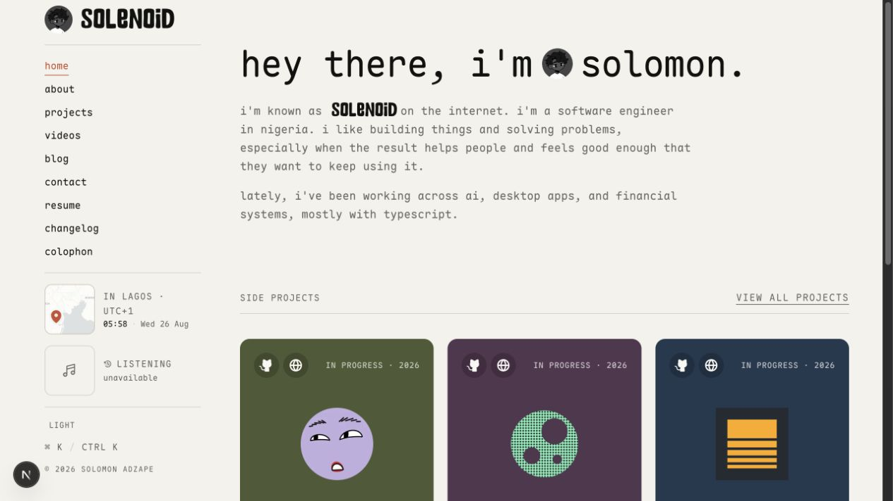

# thesolenoid.space

Solomon Adzape’s personal portfolio: projects, experience, and the things I’m currently building.



Built with Next.js, React, TypeScript, Tailwind CSS, Maple Mono, and Selera.

## Run locally

```bash
pnpm install
pnpm dev
```

Project content lives in `public/content/projects`. Last.fm uses `LASTFM_API_KEY` and `LASTFM_USERNAME`; analytics use the Umami website ID plus the PostHog variables listed in `.env.example`. Set `STATS_PASSWORD` to protect the private dashboard.

```bash
pnpm typecheck
pnpm lint
pnpm build
```
